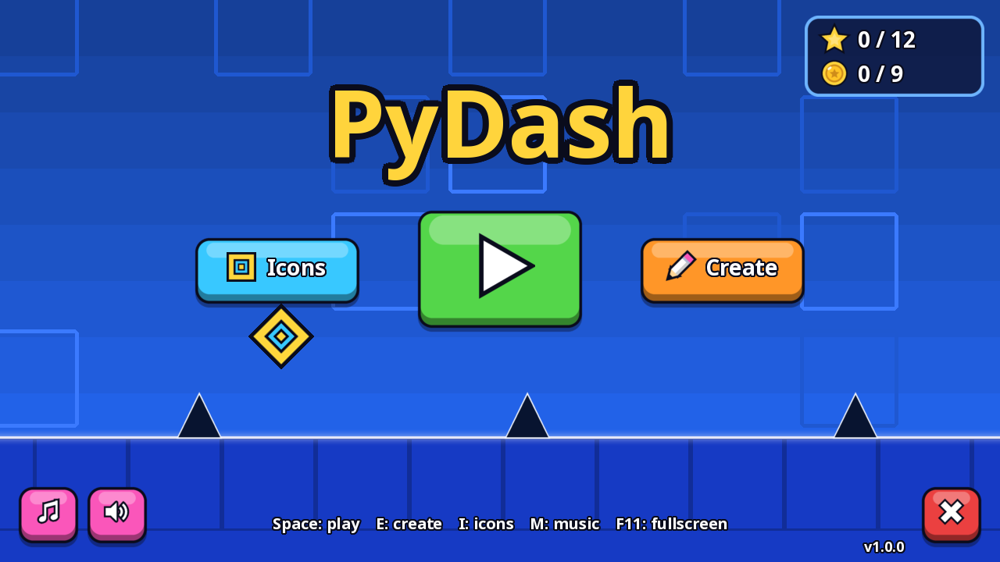
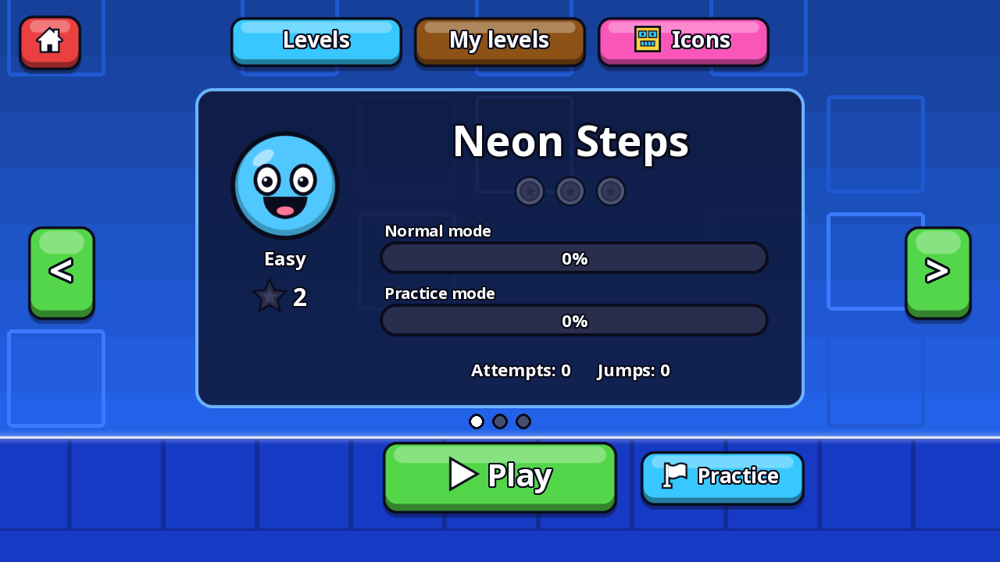
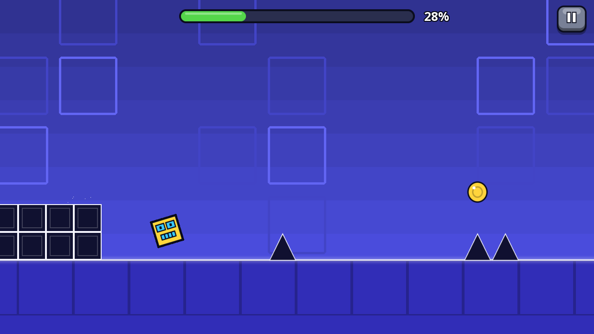
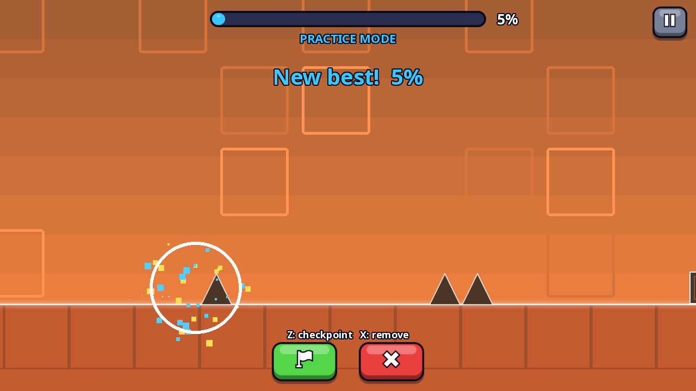
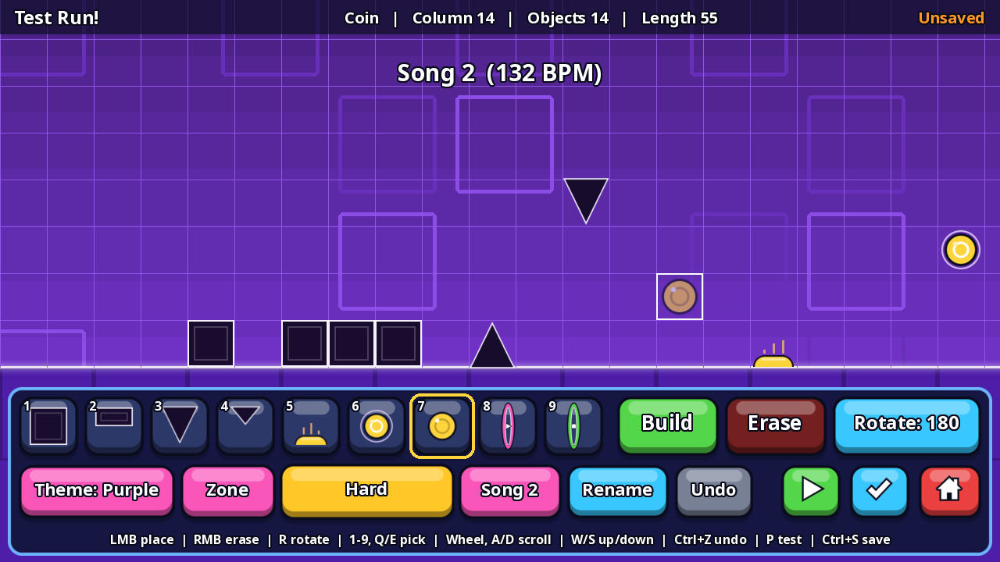
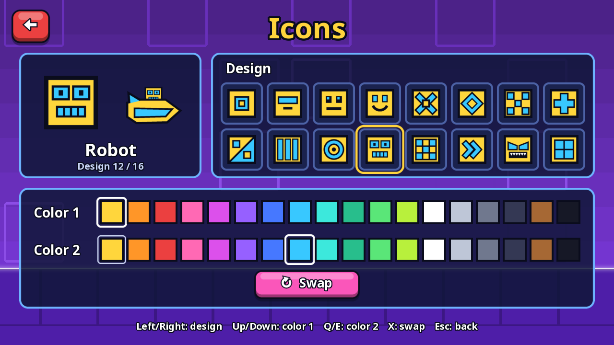
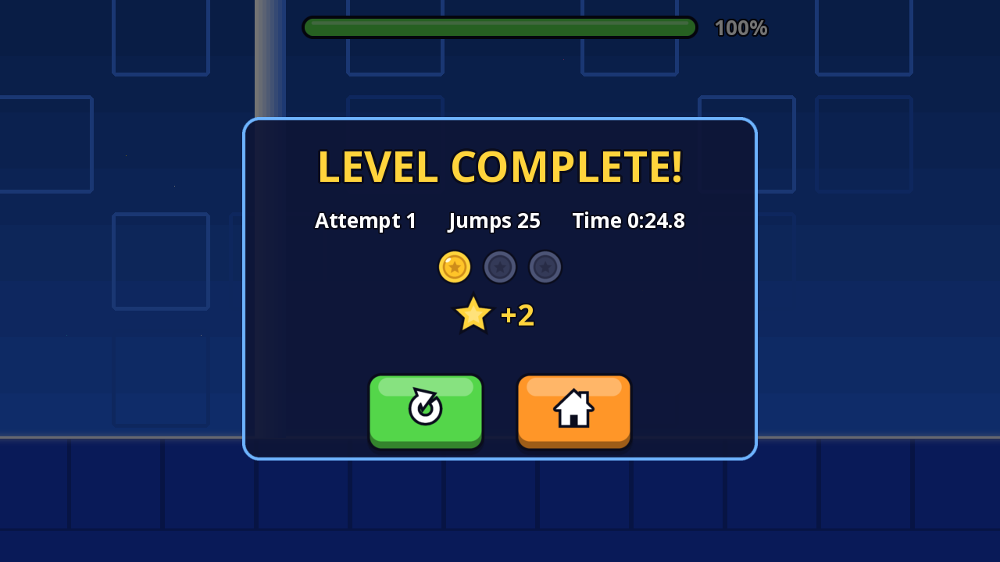

# PyDash

Ритм-платформер в духе Geometry Dash на Python и pygame: три официальных уровня, режим практики,
редактор уровней, сохранение прогресса и полностью сгенерированные музыка и звуки
(в проекте нет ни одного аудиофайла — всё синтезируется кодом).



| | |
|---|---|
|  |  |
|  |  |
|  |  |

## Запуск

Нужен Python 3.10 или новее.

```bash
pip install -r requirements.txt
python main.py          # или: python -m pydash
```

Музыка синтезируется в фоне при запуске, игра в это время уже работает.

## Что есть в игре

| Уровень | Сложность | Звёзды | Что внутри |
|---|---|---|---|
| Neon Steps | Easy | 2 | куб, батуты, сфера прыжка |
| Ember Drift | Normal | 4 | секция на корабле |
| Frost Circuit | Hard | 6 | корабль и плотные ряды шипов |

- У каждого уровня своя музыка, цветовые зоны и 3 монеты.
- Режимы куба и корабля, батуты, сферы прыжка, порталы, монеты, шипы и плиты.
- **Практика** — чекпоинты (Z — поставить, X — удалить) и отдельный рекорд практики.
- **Редактор** — 9 типов объектов, рисование протягиванием мыши, поворот, отмена и повтор,
  цветовые зоны (8 тем), сложность, выбор сгенерированной песни, тест-прогон, сохранение.
- **Прогресс** — рекорды, попытки, прыжки, монеты и звёзды сохраняются автоматически.
- **Иконки** — экран Icons: 16 дизайнов куба с резкими углами и 18 цветов для основного и второго цвета;
  выбранная иконка используется и для куба, и для корабля.
- Все значки, кнопки, лица сложности, звёзды, монеты, шипы, сферы и порталы рисуются со сглаживанием.
- Полноэкранный режим (F11), отдельные переключатели музыки и звуков.

## Управление

### В игре

| Действие | Клавиши |
|---|---|
| Прыжок, на корабле — подъём (удерживать) | Пробел, ↑, W или левая кнопка мыши |
| Пауза | Esc или P |
| В паузе: продолжить / заново / выйти | Пробел или Enter / R / Q |
| В паузе: практика вкл/выкл / музыка | T / M |
| Практика: поставить / удалить чекпоинт | Z / X |
| После финиша: ещё раз / выйти | Пробел, Enter или R / Esc или Q |

### Меню и выбор уровня

| Действие | Клавиши |
|---|---|
| Играть | Пробел или Enter |
| «Create» — свои уровни и редактор | E |
| Экран «Icons» — иконка игрока | I |
| Музыка / звуки | M / S |
| Листать уровни | ← → или A / D |
| Вкладки «Levels» / «My levels» / «Icons» | 1 / 2 / 3 |
| Практика / новый уровень | P / N |
| Назад, выход из игры | Esc |
| Полный экран | F11 |

### Экран Icons

| Действие | Управление |
|---|---|
| Дизайн куба | клик по клетке, ← → или A / D |
| Основной цвет | клик по цвету в ряду «Color 1», ↑ ↓ или W / S |
| Второй цвет | клик по цвету в ряду «Color 2», Q / E |
| Поменять цвета местами | кнопка «Swap» или X |
| Назад | Esc |

Выбор сохраняется сразу.

### Редактор

| Действие | Управление |
|---|---|
| Поставить / стереть объект | левая / правая кнопка мыши (можно вести мышью) |
| Двигать камеру | средняя кнопка мыши, колесо (Shift + колесо — по вертикали), стрелки или WASD (с Shift быстрее), Home / End |
| Выбрать объект | 1–9, Q / E — предыдущий / следующий |
| Повернуть шип или плиту | R |
| Режим «строить» / «стирать» | B / X или Delete |
| Отменить / повторить | Ctrl+Z / Ctrl+Y или Ctrl+Shift+Z |
| Сохранить | Ctrl+S |
| Тест-прогон | P или Enter |
| Выйти с сохранением | Esc |

Кнопки внизу экрана: **Theme** — цветовая тема, **Zone** — добавить, сдвинуть или убрать цветовую зону
в центре экрана, **сложность** (от неё зависят звёзды: 1, 2, 3, 5 или 8), **Song** — другая сгенерированная
мелодия, **Rename** — переименовать уровень. На уровне может быть не больше 3 монет.

## Где хранятся данные

Прогресс и ваши уровни лежат в папке `userdata/` рядом с игрой:

- `userdata/save.json` — рекорды, настройки, выбранная иконка и её цвета;
- `userdata/levels/level_N.json` — уровни из редактора.

Другую папку можно задать переменной окружения `PYDASH_USER_DIR`.

## Формат уровня

```json
{
  "format": 1,
  "name": "My Level 1",
  "difficulty": "normal",
  "stars": 2,
  "music": {"bpm": 128, "root": 57, "seed": 3},
  "colors": [{"x": 0, "theme": "blue"}, {"x": 60, "theme": "purple"}],
  "objects": [
    {"type": "block", "x": 20, "y": 0},
    {"type": "spike", "x": 24, "y": 0, "rot": 180}
  ]
}
```

- `x`, `y` — клетка сетки; `y = 0` — первый ряд над землёй, в редакторе доступны ряды 0–8.
- `type`: `block`, `slab`, `spike`, `small_spike`, `pad`, `orb`, `coin`, `portal_ship`, `portal_cube`.
- `rot` — поворот в градусах (0, 90, 180, 270) для `slab`, `spike`, `small_spike`.
- `colors` — цветовые зоны с колонки `x`; темы: `blue`, `purple`, `magenta`, `orange`, `red`, `teal`, `green`, `night`.
- `difficulty`: `easy`, `normal`, `hard`, `harder`, `insane`.
- `music` — темп, тоника (MIDI-нота) и зерно генератора мелодии.

## Проверки

```bash
python tools/verify_levels.py
```

Решатель ищет маршрут через каждый официальный уровень — просто до финиша и со сбором всех монет — и
повторяет его на настоящей физике игры.

```bash
pip install -r requirements-dev.txt
PYTHONPATH=tools/pygame_shim python tools/smoke_test.py shots
```

Windows (PowerShell): `$env:PYTHONPATH="tools/pygame_shim"; python tools/smoke_test.py shots`

Дымовой тест запускает всю игру без окна на маленьком эмуляторе pygame (`tools/pygame_shim`, рисует через
Pillow). Он проходит меню, проходит Neon Steps по маршруту решателя, проверяет практику, паузу, все
инструменты редактора, тест-прогон, сохранение и удаление своих уровней — 52 проверок — и складывает
скриншоты в указанную папку. Тест работает во временной папке и не трогает ваши сохранения.

## Структура проекта

```
main.py               запуск игры
pydash/
  config.py           константы, цвета, темы
  level.py            объекты, загрузка и сохранение уровней
  physics.py          детерминированная физика (240 шагов в секунду)
  solver.py           поиск маршрута через уровень
  draw.py             отрисовка мира, игрока и эффектов
  ui.py               кнопки, панели, текст
  gfx.py              сглаженная отрисовка (суперсэмплинг), основа кнопок и панелей
  glyphs.py           значки, лица сложности, звёзды и монеты
  skins.py            дизайны куба и корабля
  audio.py            синтез музыки и звуков
  save.py             прогресс и настройки
  game.py             игровой цикл и переключение сцен
  scenes/             menu, select, icons, play, editor
levels/               официальные уровни (JSON)
assets/fonts/         шрифт PyDash Sans
tools/                build_levels.py (генерирует официальные уровни), verify_levels.py,
                      smoke_test.py, pygame_shim/
docs/screenshots/     скриншоты
```

## Шрифт

PyDash Sans — изменённая версия Noto Sans, распространяется по лицензии SIL Open Font License
(`assets/fonts/OFL.txt`).
